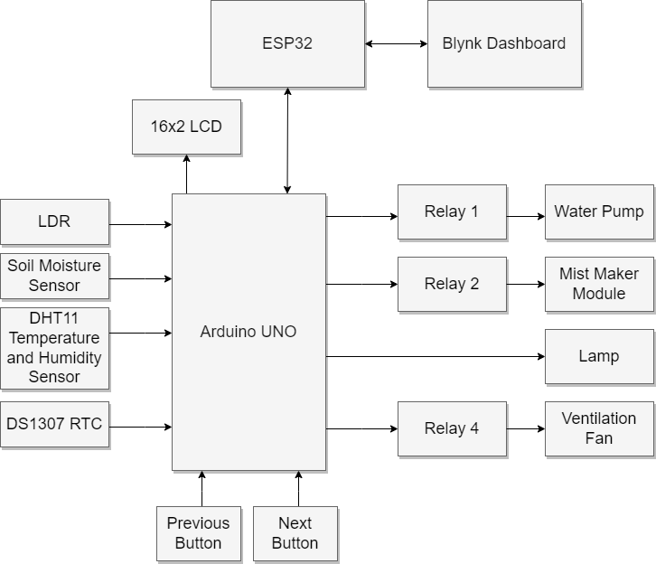

# Automated Plant Growth Support System

An Arduino Nano and ESP32 DevKit based automated plant monitoring and growth support system.

The system monitors environmental conditions such as temperature, humidity, soil moisture, and light intensity. Based on the selected plant and growth stage, the system automatically controls a water pump, misting system, cooling fan, and grow light.

The ESP32 provides a Blynk-based dashboard for monitoring sensor values and modifying plant growth presets.

---

## Features

- Temperature monitoring
- Humidity monitoring
- Soil moisture monitoring
- Light intensity monitoring
- DS1307 real-time clock
- Automatic water pump control
- Automatic misting control
- Automatic fan control
- Automatic grow-light control
- 16x2 LCD display
- Physical stage navigation buttons
- Plant and growth-stage presets
- ESP32 Wi-Fi connectivity
- Blynk dashboard
- Remote preset modification
- Arduino Nano + ESP32 UART communication

---

## System Architecture

## ESP32 DevKit Pin Connections

### Power Connections

| ESP32 Pin | Connect To | Purpose |
|---|---|---|
| `GND` | Arduino Nano `GND` | Common ground |
| `3V3` | 3.3 V peripherals | 3.3 V supply |
| `USB` | PC / USB power supply | Power and programming |

### UART Connections

| ESP32 Pin | Arduino Nano Pin | Direction | Purpose |
|---|---|---|---|
| `GPIO16 (RX2)` | `D1 / TX` via level shifter / voltage divider | Nano → ESP32 | UART receive |
| `GPIO17 (TX2)` | `D0 / RX` | ESP32 → Nano | UART transmit |
| `GND` | `GND` | — | Common ground |

> **Important:** The Arduino Nano uses 5 V logic, while the ESP32 uses 3.3 V logic. A voltage divider or logic-level converter must be used between Arduino Nano `D1/TX` and ESP32 `GPIO16/RX2`.

## Arduino Nano Pin Connections

### Complete Pinout

| Arduino Nano Pin | Connected To | Purpose |
|---|---|---|
| `D0 / RX` | ESP32 `GPIO17 / TX2` | UART receive |
| `D1 / TX` | ESP32 `GPIO16 / RX2` via level shifter | UART transmit |
| `D2` | Fan Relay `IN` | Fan control |
| `D4` | Mist Relay `IN` | Misting control |
| `D5` | Pump Relay `IN` | Pump control |
| `D6` | LCD `RS` | LCD control |
| `D7` | LCD `E` | LCD control |
| `D8` | LCD `D4` | LCD data |
| `D9` | LCD `D5` | LCD data |
| `D10` | LCD `D6` | LCD data |
| `D11` | LCD `D7` | LCD data |
| `D12` | PREV Button | Previous stage |
| `D13` | DHT11 `DATA` | Temperature / humidity |
| `A0` | LDR analog output | Light intensity |
| `A1` | Soil sensor `AO` | Soil moisture |
| `A2` | NEXT Button | Next stage |
| `A3` | NeoPixel `DIN` | Grow light control |
| `A4` | DS1307 `SDA` | I²C data |
| `A5` | DS1307 `SCL` | I²C clock |
| `5V` | Module VCC | 5 V supply |
| `GND` | Common ground | Ground |

## Sensor Connections

### DHT11

| DHT11 Pin | Arduino Nano Pin | Purpose |
|---|---|---|
| `DATA` | `D13` | Temperature / humidity data |
| `VCC` | `5V` | Power |
| `GND` | `GND` | Ground |

### Soil Moisture Sensor

| Soil Sensor Pin | Arduino Nano Pin | Purpose |
|---|---|---|
| `AO` | `A1` | Analog soil moisture |
| `VCC` | `5V` | Power |
| `GND` | `GND` | Ground |

### LDR

The LDR is connected as a voltage-divider circuit.

| LDR Circuit | Arduino Nano Pin | Purpose |
|---|---|---|
| Analog output | `A0` | Light intensity |
| VCC | `5V` | Power |
| GND | `GND` | Ground |

### DS1307 RTC

| DS1307 Pin | Arduino Nano Pin | Purpose |
|---|---|---|
| `SDA` | `A4` | I²C data |
| `SCL` | `A5` | I²C clock |
| `VCC` | `5V` | Power |
| `GND` | `GND` | Ground |

## 16x2 LCD Connections

The LCD is connected in 4-bit parallel mode.

| LCD Pin / Signal | Arduino Nano Pin | Purpose |
|---|---|---|
| `RS` | `D6` | Register Select |
| `E` | `D7` | Enable |
| `D4` | `D8` | Data |
| `D5` | `D9` | Data |
| `D6` | `D10` | Data |
| `D7` | `D11` | Data |
| `VSS` | `GND` | Ground |
| `VDD` | `5V` | Power |
| `RW` | `GND` | Write mode |
| `V0` | Potentiometer wiper | Contrast |
| `A / LED+` | `5V`* | Backlight |
| `K / LED-` | `GND` | Backlight |

> *Connect the LCD backlight according to the specifications of the LCD module. A current-limiting resistor may be required.

## NeoPixel Grow Light Connections

The system uses 3 NeoPixels.

| NeoPixel Pin | Arduino Nano Pin | Purpose |
|---|---|---|
| `DIN` | `A3` | LED data |
| `VCC` | `5V` | Power |
| `GND` | `GND` | Ground |

## Relay and Actuator Connections

The relay outputs are active-low.

| Device | Relay Input | Arduino Nano Pin | Logic |
|---|---|---|---|
| Water Pump | `Pump IN` | `D5` | `LOW = ON` |
| Misting System | `Mist IN` | `D4` | `LOW = ON` |
| Cooling Fan | `Fan IN` | `D2` | `LOW = ON` |

### Relay Module Power

| Relay Module Pin | Connection |
|---|---|
| `VCC` | `5V` |
| `GND` | `GND` |
| `Pump IN` | Arduino Nano `D5` |
| `Mist IN` | Arduino Nano `D4` |
| `Fan IN` | Arduino Nano `D2` |

> **Warning:** Do not connect the pump, fan, or misting system directly to Arduino GPIO pins. Use a suitable relay, transistor, or MOSFET driver and an appropriate external power supply for the loads.

## Push Button Connections

| Button | Arduino Nano Pin | Purpose |
|---|---|---|
| `NEXT` | `A2` | Move to next growth stage |
| `PREV` | `D12` | Move to previous growth stage |

> The current code configures both button pins as normal `INPUT`. Therefore, the button circuit requires appropriate external pull-up or pull-down resistors.

### UART Communication

The Arduino Nano and ESP32 communicate using UART at **9600 baud, 8N1**.

| Arduino Nano | ESP32 DevKit | Function |
|---|---|---|
| D1 / TX | GPIO16 / RX2 | Arduino → ESP32 |
| D0 / RX | GPIO17 / TX2 | ESP32 → Arduino |
| GND | GND | Common ground |

> **Voltage Level:** Arduino Nano uses 5 V logic while ESP32 uses 3.3 V logic. A voltage divider or level shifter must be used between Arduino D1/TX and ESP32 GPIO16/RX2. ESP32 GPIO17/TX2 can be connected directly to Arduino D0/RX.

## Example Blynk Dashboard

